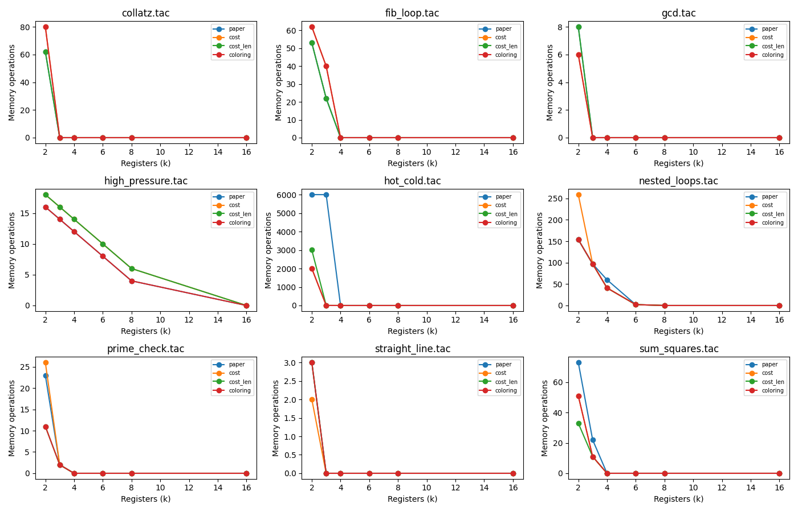
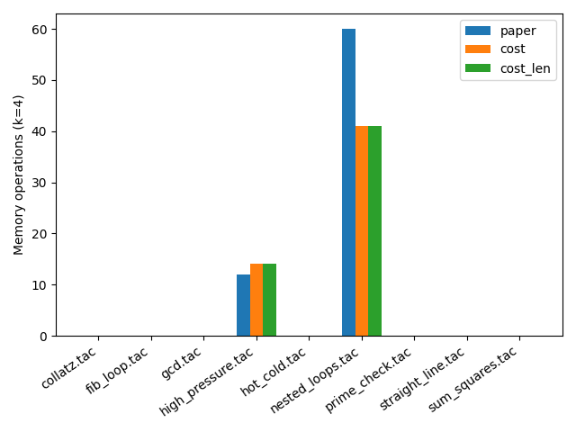
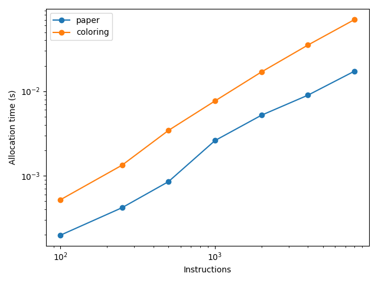

# Linear Scan Register Allocation: Implementation and Evaluation

A from-scratch Python implementation of **Linear Scan Register Allocation** (Poletto & Sarkar, 1999), extended with a **cost-based spill heuristic** and compared against a **graph-coloring baseline**. Programs are written in a small three-address-code (TAC) language and executed by an interpreter that simulates a real register file, so every allocation is checked for correctness and measured by how many memory accesses it causes at run time.

Compiler Design course project (literature review + implementation).

---

## Table of contents

1. [What problem are we solving?](#1-what-problem-are-we-solving)
2. [The reference paper](#2-the-reference-paper)
3. [What this project implements](#3-what-this-project-implements)
4. [Our extension: cost-based spilling](#4-our-extension-cost-based-spilling)
5. [Experimental setup](#5-experimental-setup)
6. [Results](#6-results)
7. [Key findings](#7-key-findings)
8. [Limitations](#8-limitations)
9. [Install and run](#9-install-and-run)
10. [Repository layout](#10-repository-layout)
11. [Future work](#11-future-work)
12. [References](#12-references)

---

## 1. What problem are we solving?

A compiler's intermediate code uses as many temporary variables as it likes:

```
a = 5
b = 10
t1 = a + b
c = t1 * 2
d = c - a
print d
```

A real CPU has only a handful of **registers** (fast storage inside the chip), while **memory** is far slower. **Register allocation** decides which variables live in registers and which are **spilled** to memory. Every access to a spilled variable costs a slow load or store, so a good allocator spills as little, and as cheaply, as possible.

### Live intervals

A variable only needs a register between its first definition and its last use: its **live interval**. Variables whose intervals overlap need different registers, and variables whose intervals do not overlap can share one.

| Variable | Defined | Last used | Interval |
|---|---|---|---|
| a | line 1 | line 5 | [1, 5] |
| b | line 2 | line 3 | [2, 3] |
| t1 | line 3 | line 4 | [3, 4] |
| c | line 4 | line 5 | [4, 5] |
| d | line 5 | line 6 | [5, 6] |

## 2. The reference paper

> M. Poletto and V. Sarkar. **Linear Scan Register Allocation.** *ACM Transactions on Programming Languages and Systems (TOPLAS)*, 21(5):895-913, 1999.

The classic approach, **graph coloring**, builds an interference graph (an edge between every pair of variables that are alive at the same time) and colors it with *k* colors, one per register. It produces good code but is expensive. Linear scan skips the graph and allocates registers in **a single pass over the live intervals**:

1. Sort the intervals by start point.
2. Keep an `active` list of intervals that currently hold a register.
3. For each new interval, **expire** active intervals that have ended and free their registers.
4. If a register is free, assign it. Otherwise **spill**: the paper spills the active interval that **ends furthest in the future**.

This makes linear scan much faster to run, which is why JIT compilers favor it, at the price of somewhat lower code quality.

## 3. What this project implements

```
TAC text -> parse -> basic blocks / CFG -> liveness -> live intervals
         -> allocator (linear scan | graph coloring) -> allocation (reg / mem per variable)
         -> interpreter with a real register file -> output check + memory-op counts
```

| Component | Description |
|---|---|
| **TAC front end** (`ir.py`) | Parser and printer for a small three-address language: assignments, arithmetic and comparisons, labels, `goto`, `if x goto`, `print`. |
| **CFG** (`cfg.py`) | Basic blocks, edges, and **loop depth** from natural loops (DFS back edges, no dominators needed). |
| **Liveness** (`liveness.py`) | Backward dataflow to a fixpoint, single-range live intervals, spill costs, per-instruction live sets. |
| **Allocators** (`allocators/`) | `paper`, `cost`, `cost_len` (linear scan variants) and `coloring` (Chaitin/Briggs-style baseline). |
| **Interpreter** (`interpreter.py`) | Runs the program with unlimited virtual registers (reference) or with a simulated register file of *k* registers plus memory. A wrong allocation corrupts values, so the interpreter doubles as a correctness check. It counts memory loads and stores. |
| **Experiments** (`experiments/`) | Sweeps benchmarks, register counts and allocators; writes CSVs, a Markdown summary and figures. |

### Allocators compared

| Name | Algorithm | Spill choice when no register is free |
|---|---|---|
| `paper` | Linear scan (Poletto & Sarkar) | Interval with the **furthest end** |
| `cost` | Linear scan | Interval with the **lowest spill cost** |
| `cost_len` | Linear scan | Lowest **spill cost / interval length** |
| `coloring` | Optimistic graph coloring (Chaitin/Briggs style), single pass | Lowest cost / degree |

### Spill model

A spilled variable lives in its own memory slot for its whole lifetime (no splitting, no live-range holes). Instructions may use memory operands directly, as on x86. Each read of a memory operand counts as one **load** and each write to a memory destination as one **store**.

## 4. Our extension: cost-based spilling

The paper's rule looks only at **how long** a variable lives, not **how often it is used**. Consider this program with a single register:

```
y = 100            # long-lived, used once at the end
x = 0              # long-lived, used constantly inside the loop
i = 0
L1:
x = x + 1
x = x * 2
x = x % 1000003
i = i + 1
c = i < 1000
if c goto L1
print y
print x
```

`x` ends last, so the paper's rule spills `x` and the hot loop pays for memory accesses on every iteration. Spilling `y` instead costs two memory operations in total. We weight each use and definition by its loop depth:

```
spill_cost(v) = sum over every def and use of v of 10 ^ (loop depth of that instruction)
```

and spill the **cheapest** variable (`cost`), or the cheapest per unit of interval length (`cost_len`). Only the spill-victim choice changes; the scan itself is identical to the paper's.

## 5. Experimental setup

- **9 hand-written benchmarks** (`benchmarks/`): `straight_line`, `hot_cold`, `fib_loop`, `gcd`, `prime_check`, `collatz`, `nested_loops`, `high_pressure`, `sum_squares`.
- **Register counts:** k in {2, 3, 4, 6, 8, 16}.
- **4 allocators** per (benchmark, k): 9 x 6 x 4 = **216 runs**.
- **Correctness:** every allocated run's output is compared against the reference run. All 216 runs match.
- **Quality metric:** *dynamic memory operations* (spill loads + stores actually executed), not just the number of spilled variables.
- **Timing:** synthetic programs of 100 to 8000 instructions at k = 8, median of repeated runs, measuring allocation work only (interval construction for linear scan, interference-graph construction plus coloring for the baseline).

## 6. Results

Full tables are generated into `results/summary.md` and `results/quality.csv`. Selected rows below (dynamic memory operations, lower is better):

| Benchmark | k | paper | cost | cost_len | coloring |
|---|---:|---:|---:|---:|---:|
| hot_cold | 2 | 6004 | **2002** | 3003 | **2002** |
| hot_cold | 3 | 6002 | **2** | **2** | **2** |
| sum_squares | 2 | 73 | 51 | **33** | 51 |
| sum_squares | 3 | 22 | **11** | **11** | **11** |
| nested_loops | 4 | 60 | **41** | **41** | **41** |
| gcd | 2 | 8 | **6** | 8 | **6** |
| prime_check | 2 | 23 | 26 | **11** | **11** |
| nested_loops | 2 | **154** | 259 | **154** | **154** |
| collatz | 2 | **62** | 80 | **62** | 80 |
| fib_loop | 3 | **22** | 40 | **22** | 40 |
| high_pressure | 4 | **12** | 14 | 14 | **12** |

For k >= 4 most benchmarks need no spills at all (0 memory operations for every allocator), which is expected for programs with few live variables.

### Memory operations vs. number of registers



### Memory operations at k = 4



### Allocation time

| Instructions | Linear scan (ms) | Coloring (ms) | Coloring / linear scan |
|---:|---:|---:|---:|
| 100 | 0.20 | 0.52 | 2.6x |
| 250 | 0.42 | 1.33 | 3.2x |
| 500 | 0.85 | 3.43 | 4.0x |
| 1000 | 2.60 | 7.66 | 2.9x |
| 2000 | 5.20 | 16.90 | 3.3x |
| 4000 | 8.97 | 35.18 | 3.9x |
| 8000 | 17.25 | 70.35 | 4.1x |



## 7. Key findings

1. **The implementation is correct.** All 216 (benchmark, k, allocator) runs reproduce the reference output on a simulated register file.
2. **Linear scan is faster than graph coloring**, consistently by about 3x to 4x across program sizes (2.6x to 4.1x). On these synthetic programs both curves grow close to linearly on a log-log plot, so we observe a constant-factor advantage and a slightly flatter curve rather than quadratic blow-up for coloring.
3. **The paper's spill rule can be costly in loops.** On `hot_cold` the furthest-end rule causes 6004 memory operations at k = 2 and 6002 at k = 3, while the cost-based rule needs 2002 and 2. This is the loop-blindness case the extension targets.
4. **The cost-based rule is not a universal improvement.** It wins on `hot_cold`, `gcd`, `sum_squares` and `nested_loops` (k = 4), but loses on `collatz`, `fib_loop`, `high_pressure` and `nested_loops` (k = 2). In `collatz` at k = 2 the cost rule spills 2 variables against 1 for the paper's rule. A plausible reason is that cost alone ignores how long a victim would have held its register, so a cheap but short-lived victim relieves little pressure and further spills follow.
5. **`cost_len` is the most balanced linear-scan variant**, matching or beating the paper's rule on most benchmarks, though it loses on `hot_cold` at k = 2 (3003 vs 2002) and on `high_pressure`.
6. **At very low k, graph coloring produces better code** than the single-interval linear scan (for example `prime_check` at k = 2: 11 vs 23 memory operations). Precise per-instruction liveness avoids the over-approximation of one [start, end] range per variable.

## 8. Limitations

- Benchmarks are small. Most reach zero spills for k >= 4, so the comparison is informative mainly for k = 2 and 3. More benchmarks with many live variables inside long-running loops would sharpen the results.
- The spill model (whole-lifetime memory slots, direct memory operands, no scratch registers) is simpler than a production back end, so absolute numbers are not comparable with the paper's. We reproduce its **qualitative** claims (speed advantage, reasonable quality), not its reported figures.
- The graph-coloring baseline is a single-pass optimistic allocator without iterative spill-and-rebuild.
- Timing is measured in Python, so absolute times are not meaningful; the ratios and growth trends are.
- Intervals are single ranges with no holes and no splitting.

## 9. Install and run

Python 3.10 or newer.

```sh
pip install -r requirements.txt        # pytest, matplotlib

# Inspect one allocation: intervals, allocation, rewritten code, run statistics
python -m regalloc show benchmarks/hot_cold.tac --k 3 --alloc cost
# --alloc is one of: paper, cost, cost_len, coloring

# Tests
pytest

# Full experiments: writes CSVs, summary.md and figures into results/
python -m experiments.run_experiments
```

To use the generated figures in this README, copy them into `docs/figures/` (the `results/` folder is ignored by Git):

```sh
mkdir -p docs/figures && cp results/figures/*.png docs/figures/
```

## 10. Repository layout

```
.
├── regalloc/
│   ├── ir.py               # TAC parser and printer
│   ├── cfg.py              # basic blocks, edges, loop depth
│   ├── liveness.py         # liveness, live intervals, spill costs
│   ├── interpreter.py      # executes TAC, simulates registers, counts memory ops
│   ├── bench_gen.py        # synthetic programs for timing
│   ├── __main__.py         # command-line interface
│   └── allocators/
│       ├── linear_scan.py  # the paper's algorithm
│       ├── heuristics.py   # spill-victim strategies
│       └── graph_coloring.py
├── benchmarks/             # *.tac test programs
├── experiments/run_experiments.py
├── tests/
├── docs/figures/           # figures shown in this README
└── results/                # generated (ignored by Git)
```

| File | Report section |
|---|---|
| `regalloc/ir.py`, `cfg.py` | Implementation |
| `regalloc/liveness.py` | Algorithm |
| `regalloc/allocators/` | Algorithm / Implementation |
| `regalloc/interpreter.py` | Implementation |
| `benchmarks/*.tac`, `bench_gen.py` | Results |
| `experiments/run_experiments.py`, `results/` | Results |
| `tests/` | Implementation validation |

## 11. Future work

- **Live-interval holes** and **second-chance binpacking** (Traub et al., 1998), which use register gaps inside an interval.
- **Interval splitting** with optimized split positions (Wimmer and Mossenbock, 2005).
- Larger benchmark suites and an explicit scratch-register model for spill code.
- A hybrid scheme that switches spill heuristics based on register pressure.

## 12. References

1. M. Poletto and V. Sarkar. *Linear Scan Register Allocation.* ACM TOPLAS 21(5):895-913, 1999. (Primary reference paper.)
2. O. Traub, G. Holloway and M. D. Smith. *Quality and Speed in Linear-scan Register Allocation.* PLDI 1998.
3. C. Wimmer and H. Mossenbock. *Optimized Interval Splitting in a Linear Scan Register Allocator.* VEE 2005.
4. G. J. Chaitin et al. *Register Allocation via Coloring.* Computer Languages 6(1), 1981.
5. P. Briggs, K. D. Cooper and L. Torczon. *Improvements to Graph Coloring Register Allocation.* ACM TOPLAS 16(3), 1994.
6. A. V. Aho, M. S. Lam, R. Sethi and J. D. Ullman. *Compilers: Principles, Techniques, and Tools*, 2nd ed. Pearson, 2012.
